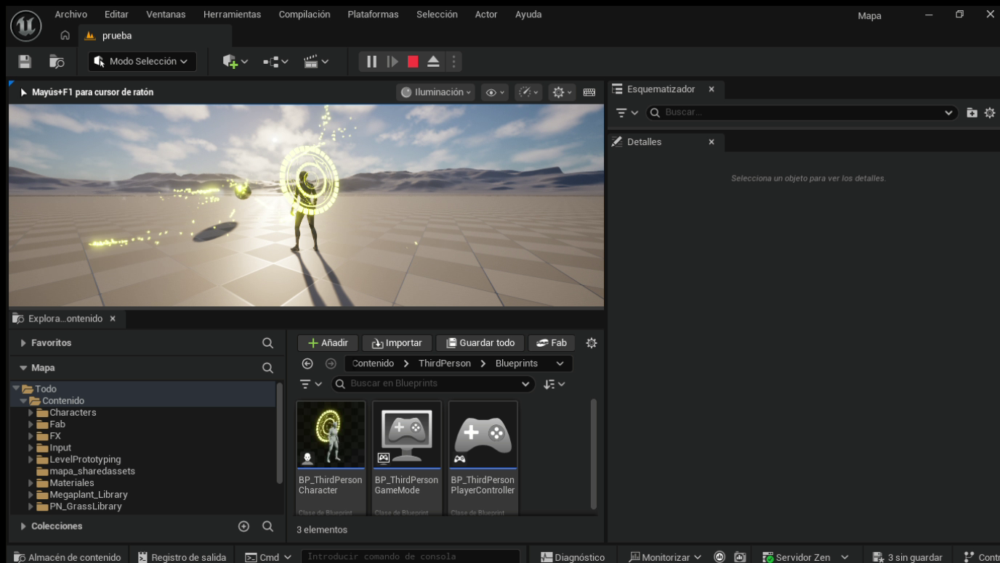
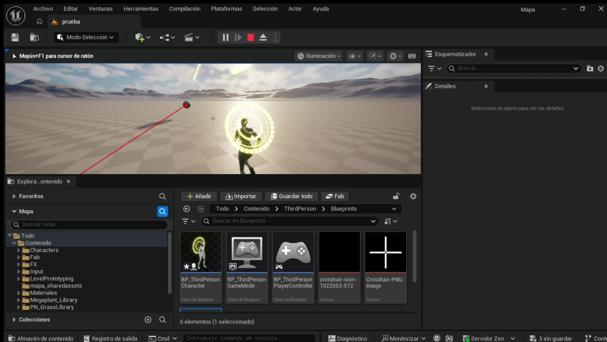
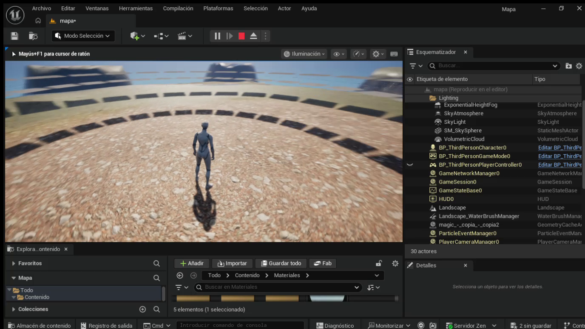
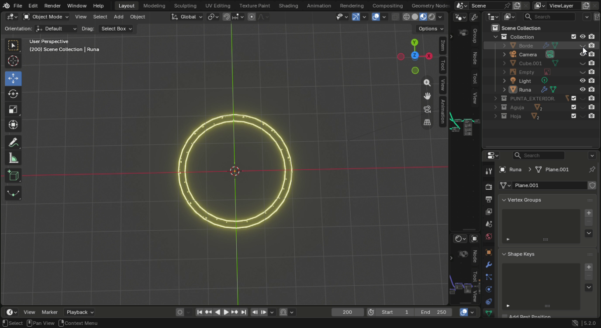

# ⚡ Real-Time Magic Circle & Niagara Particle VFX (Unreal Engine 5)

<p align="left">
  
  
  
  
</p>

A real-time magical rune aura and particle visual effects (VFX) system authored for **Unreal Engine 5**, featuring custom layered 3D rune geometry designed in **Blender**, emissive PBR shader materials, dynamic laser line-trace targeting, and high-performance **Niagara GPU particle simulation** integrated with a Third-Person Character.

---

## 🌟 Visual Showcase

### 1. Magical Rune Aura & Orbital Particle System
> Real-time emissive rune circle hovering behind the character with dynamic swirling particle trails and volumetric lighting.



---

### 2. Third-Person Motion & Laser Targeting System
> Character mobility with socket-attached rotational rune, screen-space crosshair HUD (`WBP_Crosshair`), and laser aim trace.



---

### 3. Arena Environment & Volumetric Lighting
> Circular stone battle arena featuring dynamic atmosphere, volumetric clouds, and exponential height fog.



---

### 4. 3D Rune Modeling in Blender
> Hierarchical rune structure (`Runa`, `Borde`, `Aguja`, `Hoja`) modeled with precise topology, UV unwrapping, and emissive material masking.



---

## ✨ Key Technical Features

- **Blender to Unreal 3D Workflow:**
  - Modeled multi-element runic circles in **Blender 5.2** with clean topology and separate UV channels for rotational animation.
  - Exported as optimized meshes with custom collision and material slots.

- **Niagara VFX Particle Simulation:**
  - GPU-accelerated particle system with curl noise velocity vector fields.
  - Color-over-lifetime curve transitions (intense golden core to warm dissipating amber).
  - Dynamic scale variations, ribbon/sprite renderers, and distance-based particle kill logic.

- **Character Blueprint Integration (`BP_ThirdPersonCharacter`):**
  - Attached rune mesh to character spine socket with continuous delta-time rotational offsets.
  - Camera boom and spring arm lag tuning for dynamic combat readability.
  - Line-trace targeting ray aligned with player camera forward vector.

- **PBR Emissive Shaders & Materials:**
  - Material instances (`M_MagicRune`, `M_Magic_LINE`, `M_Magic_RUNE`) with exposed parameters for glow intensity, fresnel edge falloff, pulse speed, and tint color.
  - Full compatibility with **Lumen** global illumination and bloom post-processing.

---

## 📁 Repository Structure

```text
unreal-vfx-magic-circle/
├── blender_source/               # Original 3D models and rune curves
│   ├── magic circle.blend
│   ├── cir2.blend
│   └── magic.blend
├── docs/screenshots/            # High-resolution demonstration captures
│   ├── vfx_magic_circle_aura.png
│   ├── vfx_targeting_motion.png
│   ├── vfx_arena_environment.png
│   └── blender_rune_model.png
└── unreal_assets/                # Exported clean Unreal Engine 5 assets
    ├── Blueprints/               # Character, Crosshair, and Projectile Blueprints
    │   ├── BP_AerialMagicCircle.uasset
    │   ├── BP_MagicProjectile1.uasset
    │   ├── BP_ThirdPersonCharacter.uasset
    │   └── WBP_Crosshair.uasset
    ├── Niagara_System/           # GPU particle emitter definitions
    │   └── NS_MagicImpact.uasset
    ├── Materials/                # Emissive shaders and material instances
    │   ├── M_MagicRune.uasset
    │   ├── M_Magic_LINE.uasset
    │   └── M_Magic_RUNE.uasset
    ├── Meshes/                   # 3D static mesh runes
    │   ├── Runa.uasset
    │   └── Runa2.uasset
    └── Textures/                 # Impact and particle sprite masks
        ├── T_MagicImpact_Flash.png
        ├── T_MagicImpact_Mist.png
        ├── T_MagicImpact_Ring.png
        └── T_MagicImpact_Spark.png
```

---

## 🛠️ Tools & Technologies Used

- **Engine:** Unreal Engine 5 (UE5)
- **VFX System:** Niagara Particle System
- **3D Modeling & UVs:** Blender 5.2 LTS
- **Scripting:** Blueprint Visual Scripting
- **Shading:** PBR Emissive Materials, Dynamic Material Instances

---

## 👨‍💻 Author

**José Miguel Rincón Martínez**  
*Systems Engineer · Backend Engineer · 3D / Real-Time Developer*

- 🌐 **LinkedIn:** [linkedin.com/in/rincon-jose-28638036b](https://www.linkedin.com/in/rincon-jose-28638036b/)
- 💻 **GitHub:** [@Jmrm16](https://github.com/Jmrm16)
- 📧 **Email:** [joserinconjmrm@gmail.com](mailto:joserinconjmrm@gmail.com)
